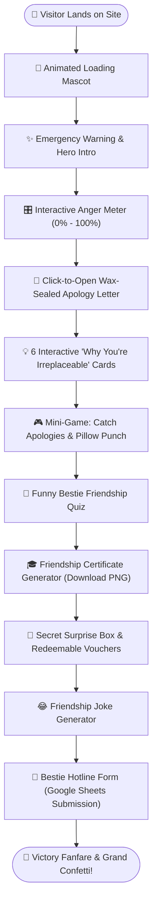
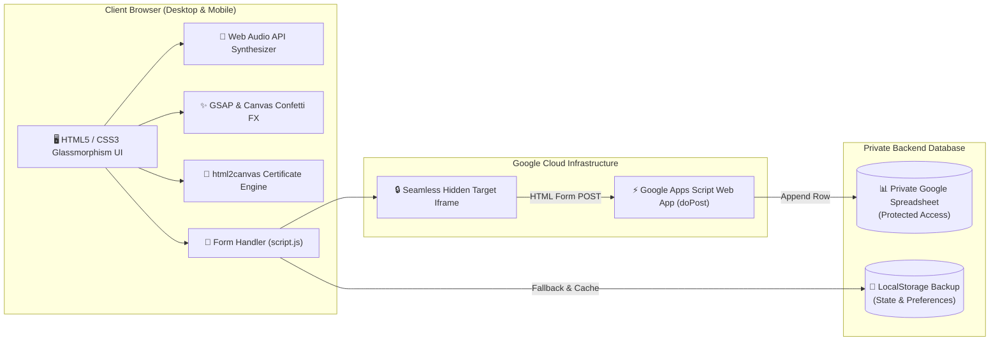
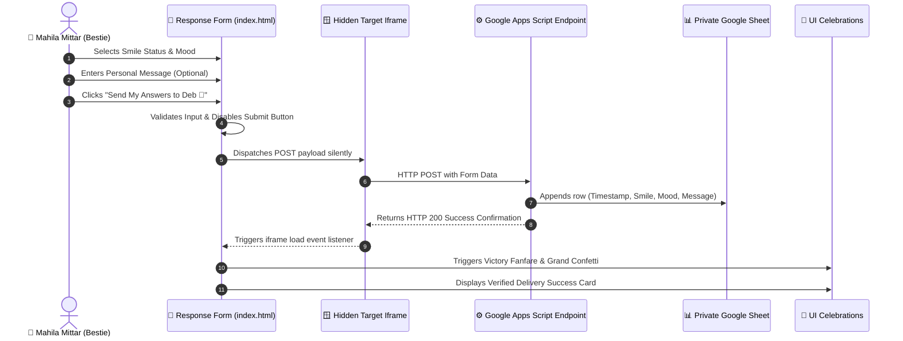
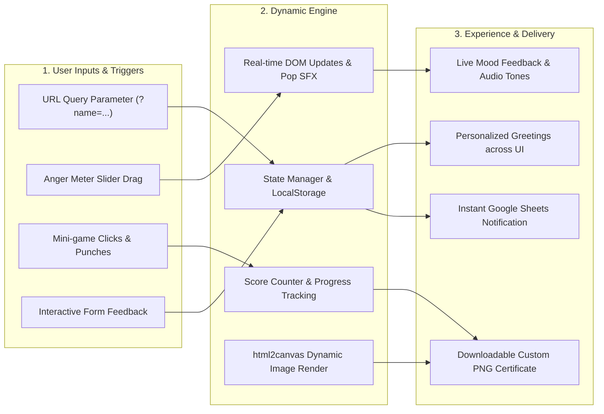

# 😂 Mission: Mahila Mittar Er Rag Bhangan 💗

**Subtitle:** One Angry Bestie. One Confused Developer. One Emergency Website!  
**Tagline:** *When a simple sorry isn't enough, a developer starts coding!*

[](LICENSE)
[](https://debp2664-ship-it.github.io/Mission-Make-my-Mahila-Mittar-Smile/)
[]()
[]()
[]()
[]()
[]()
[]()

---

## 📖 The Story Behind The Mission

It was an ordinary day until catastrophe struck: **Mahila Mittar got furious.** 🚨

Normally, mortals apologize with chocolate, a sad puppy-face emoji, or a paragraph text. But as a software developer, ordinary apologies were simply illegal. When git commits can't fix real-life bugs and stack overflow has no answers for *"Keno eto rag?"*, there was only one emergency protocol remaining:

> **Operation: Deploy an Interactive Bestie Apology Experience directly to production before the anger meter hits critical mass!**

Welcome to **Mission: Mahila Mittar Er Rag Bhangan** — an interactive friendship apology and celebration web application built with humor, sincerity, modern web animation, and Google Sheets integration.

---

## 🌟 Project Overview & Objectives

| Objective | Description |
| :--- | :--- |
| **Primary Goal** | De-escalate bestie anger and bring a genuine smile back to her face. |
| **Interactive Storytelling** | Guide the visitor through a multi-stage emotional journey from laughter to genuine sincerity. |
| **Zero-Friction Response** | Allow her to effortlessly submit her mood and candid thoughts directly to a private Google Sheet. |
| **Privacy First** | Ensure voluntary feedback remains private between best friends without third-party tracking. |
| **Portfolio Showcase** | Demonstrate clean vanilla web engineering, Web Audio API synthesis, dynamic DOM manipulation, and serverless forms. |

---

## ✨ Key Features & Highlights

- **🎛️ Interactive Anger Meter (0% – 100%)**: Dynamic slider that reacts in real-time with custom Bengali & English humor quotes, emoji shifts, and custom sound feedback.
- **💌 Wax-Sealed Apology Letter**: Beautiful CSS envelope with realistic opening flap animation revealing a genuine apology note.
- **💡 6 Reasons Why You're Irreplaceable**: Interactive 3D tilt cards with hover animations and celebratory particle bursts.
- **🥊 Pillow Punch & Mistake-Fixer Mini-Game**: Interactive stress-relief clicker game where she can virtually punch pillows and pop floating mistakes.
- **📝 The Hilarious Friendship Quiz**: Custom bestie questionnaire with dynamic scoring, humorous reaction badges, and instant roasts.
- **📜 Downloadable Friendship Certificate**: Client-side high-resolution PNG generation using `html2canvas` — ready to download and keep forever.
- **🎁 Secret Surprise Box & Redeemable Vouchers**: Interactive virtual gift box that pops open with unconditional friendship vouchers (e.g., Free Coffee, 2 AM Vent Session).
- **🎵 Zero-Dependency Web Audio Synthesizer**: Built-in sound effects (pops, chimes, victory fanfares) generated mathematically using the browser's native `AudioContext`.
- **📮 Direct Google Sheets Hotline**: Seamless form submission powered by Google Apps Script and hidden iframe target (zero page reloads).
- **🕹️ Private Admin HQ (`admin.html`)**: Companion dashboard with Firebase Firestore integration and local simulation mode for response inspection.

---

## 📊 Application Architecture & Flowcharts

### 1. Website User Flowchart
How a visitor progresses through the emotional recovery workflow:



---

### 2. System Architecture Diagram
Overview of client-side modules, Google Apps Script serverless proxy, and Google Sheets storage:



---

### 3. Response Submission Flowchart
Detailed sequence of cross-origin form submission without external page navigation:



---

### 4. Project Workflow Diagram
State orchestration, sound triggers, and visual updates:



---

## 🛠️ Technology Stack

| Layer | Technologies Used |
| :--- | :--- |
| **Markup & Semantics** | HTML5 (Semantic elements, Accessibility tags, Meta OpenGraph) |
| **Styling & Effects** | Vanilla CSS3 (Custom Properties, Glassmorphism, CSS Grid, Flexbox, Keyframe Animations) |
| **Logic & State** | Vanilla JavaScript (ES6+, DOM Event Delegation, LocalStorage API) |
| **Audio Engine** | Web Audio API (Native browser synthesizer for zero-latency procedural SFX) |
| **Animation Libraries** | [GSAP 3.12](https://greensock.com/gsap/) & [Canvas Confetti](https://www.kirilv.com/canvas-confetti/) |
| **Certificate Export** | [html2canvas 1.4.1](https://html2canvas.hertzen.com/) |
| **Serverless Integration** | Google Apps Script (`doPost` handler) |
| **Data Storage** | Google Sheets & optional Firebase Cloud Firestore |
| **Deployment** | GitHub Pages & Vercel |

---

## 📮 Google Sheets & Google Apps Script Integration

To enable bestie feedback without requiring database servers or authentication walls, the application leverages **Google Apps Script as a serverless microservice**:

1. **HTML Form Dispatch**:
   The response form uses standard HTML POST targeted into a hidden iframe (`target="hidden_iframe"`). This bypasses browser CORS restrictions and prevents disruptive page reloads.
2. **Apps Script Web App**:
   The deployed script receives the POST request and extracts parameters (`smile`, `mood`, `message`).
3. **Google Sheet Storage**:
   The script appends a timestamped row to the owner's private Google Spreadsheet.
4. **Instant Client Feedback**:
   The hidden iframe triggers its `onload` handler in JavaScript, verifying delivery, triggering confetti animations, and displaying a personalized thank-you card.

---

## 🔒 Privacy, Security & Disclosures

Security and privacy have been prioritized throughout development:

* **Private Spreadsheet**: The destination Google Sheet is restricted exclusively to the developer's Google account and is never made public.
* **No Tracking**: The website contains no telemetry, cookies, IP logger, or advertising trackers.
* **Transparent Visitor Disclosure**: The form explicitly informs the visitor before submission: *"Your answers and message will be sent directly to Deb. This form is 100% optional!"*
* **Frontend Web App URL Disclosure**:
  > [!NOTE]
  > The Google Apps Script deployment URL is embedded in client-side HTML. In web applications, any frontend endpoint is inherently inspectable via browser DevTools. While spreadsheet contents remain private, anyone with the endpoint URL can submit data. In this project, client-side input validation and payload constraints help keep the hotline clean.

---

## 🚀 Installation & Local Setup

Running the project locally requires no compilers, package managers, or dependencies:

1. **Clone the repository**:
   ```bash
   git clone https://github.com/debp2664-ship-it/Mission-Make-my-Mahila-Mittar-Smile.git
   cd Mission-Make-my-Mahila-Mittar-Smile
   ```

2. **Open in your browser**:
   - Simply double-click `index.html` to open directly in any modern browser, or
   - Use a lightweight local server:
     ```bash
     npx serve .
     ```

3. **Personalized Greeting**:
   Pass a custom name via the URL query string:
   ```text
   http://localhost:3000/?name=Priyanka
   ```

---

## 📁 Project Directory Structure

```text
├── index.html            # Main interactive bestie apology experience
├── admin.html            # Private admin responses dashboard
├── style.css             # Glassmorphism design system, responsive layouts & animations
├── script.js             # Web Audio API, mini-games, GSAP animations & form logic
├── firebase-config.js    # Firebase configuration & simulation fallback wrapper
├── firestore.rules       # Security rules for Firestore Database
├── FIREBASE_SETUP.md     # Firebase setup guide & simulation instructions
├── vercel.json           # Vercel deployment configuration
├── .gitignore            # Git exclusion rules for clean repository state
├── LICENSE               # Official MIT License
└── README.md             # Project documentation & architecture
```

---

## 🌐 GitHub Pages Deployment Guide

This project is 100% static and directly compatible with **GitHub Pages**:

1. In your GitHub repository, navigate to **Settings** → **Pages**.
2. Under **Build and deployment** → **Source**, select **Deploy from a branch**.
3. Under **Branch**, select `main` and folder `/ (root)`, then click **Save**.
4. GitHub Pages will deploy your site at:
   ```text
   https://debp2664-ship-it.github.io/Mission-Make-my-Mahila-Mittar-Smile/
   ```

---

## 💡 What I Learned & Engineering Challenges

| Challenge | Engineering Solution |
| :--- | :--- |
| **CORS on Form POST** | Standard `fetch()` calls to Google Apps Script fail CORS preflight in browsers. Resolved cleanly using a hidden iframe target with an `onload` listener. |
| **Audio Bloat & Lag** | External MP3 files cause network latency and loading pauses. Implemented procedural sound synthesis using native `AudioContext` oscillators. |
| **High-Res Certificate** | Rendered custom SVG/HTML certificates on-the-fly and converted them to downloadable 2x canvas blobs using `html2canvas`. |
| **Humor & Sensitivity** | Designed user-centric copy that balances lighthearted humor with genuine accountability and warmth. |

---

## 🔮 Future Improvements

- [ ] Add background lo-fi music player with a mute toggle.
- [ ] Add custom sticker pack downloads for WhatsApp / Telegram.
- [ ] Add multi-language toggle (Bengali / English / Hindi).
- [ ] Add sound effect customization presets (Retro 8-bit / Cute Chimes / Piano).

---

## 👨‍💻 Developer Information

- **Developer:** **Deb Paul**
- **GitHub:** [@debp2664-ship-it](https://github.com/debp2664-ship-it)
- **Role:** Full-Stack Developer & Problem Solver (especially bestie emergency situations!)

---

## 📄 License

This project is open-source and licensed under the **MIT License**.

See the [LICENSE](LICENSE) file for complete details.

```text
Copyright (c) 2026 Deb Paul
```

### Third-Party Assets & Compatibility Notice
- **Google Fonts** (Dancing Script, Poppins, Quicksand): Licensed under the [SIL Open Font License 1.1](https://scripts.sil.org/OFL).
- **GSAP**: Free for standard non-commercial and web application use under the GreenSock License.
- **Canvas Confetti**: Licensed under the [MIT License](https://github.com/catdad/canvas-confetti/blob/master/LICENSE) (Kiril Vatev).
- **html2canvas**: Licensed under the [MIT License](https://github.com/niklasvh/html2canvas/blob/master/LICENSE) (Niklas von Hertzen).

All included third-party libraries are fully compatible with this repository's open-source distribution.

---

*Made with 💗, patience, and gallons of coffee by [Deb Paul](https://github.com/debp2664-ship-it).*
